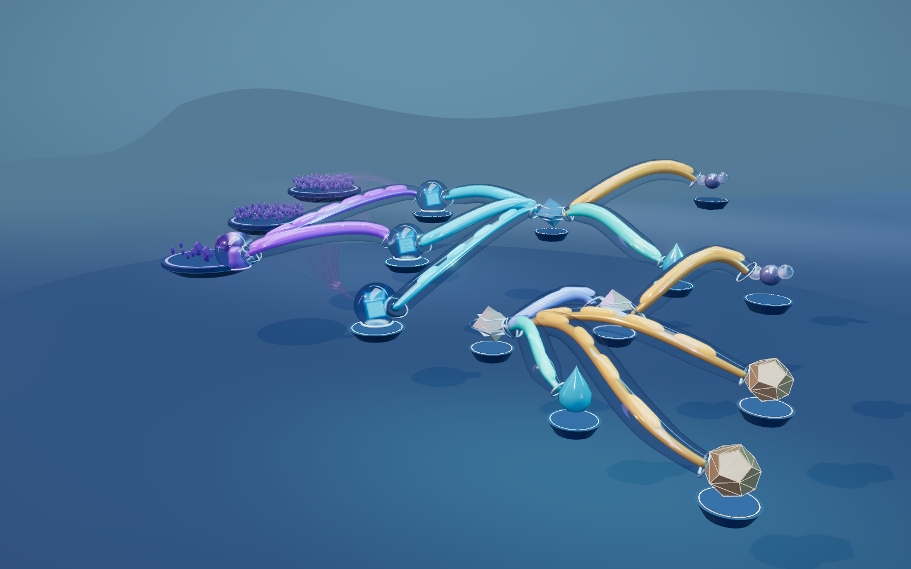

# Climatico — a living business landscape

A full-screen, interactive 3D business scene. Individual clients, products, operations, and environmental records inhabit a connected landscape of crystal vessels, dark floating platforms, and rounded translucent conduits with moving interiors.



## Explore

- Drag to orbit; right-drag to pan; scroll or pinch to zoom.
- Select an entity to follow its recorded route and reveal its name in the scene.
- Press Escape to return to the overview.
- Press Space to pause or resume flow motion. System reduced-motion preferences are respected.

There are no dashboard panels, chat windows, timeline controls, or prompt-to-scene tools in the visible experience.

## Run

```sh
npm install
cp .env.example .env
npm run dev
```

The optional server-side Meta endpoint accepts `MODEL_API_KEY` (the local `meta_api_key` alias also works). Keys remain in ignored environment files or server-side secrets and are never sent to the browser.

## Meta's role in development

Meta Muse Spark was used as a technical-art collaborator: it reviewed the actual rendered screenshot, selected concept image, and React Three Fiber scene source. Its feedback informed the dusk palette, selective transmission, dark reflective floor, fewer structural supports, sparse native 3D labels, and deeper composition. See [the review and implementation notes](design/research/meta-art-collaboration.md).

The mistakenly added prompt-to-scene product feature was removed. The earlier `/api/ask` server endpoint remains available in source but has no visible chat interface in this scene. Baseten, Modal, and Fireworks runtime integrations remain planned, not connected.

## Entities and connections

The latest illustrative snapshot contains 260 separate entities: 248 individual B2B clients, three product lines, three operational records, two emissions records, two water records, and two material/waste records. All 308 configured directed relationships remain represented. The active route receives solid channels; secondary client relationships are batched. Each client retains a distinct ID and picking target.

All business data and environmental methods are illustrative. No real company account is connected. Water, material mass, and CO₂e keep their own records and native units. A connection does not establish causation or allocate environmental impacts to a client. Geometry size, pedestal height, light, and pulse speed are visual design choices, not measured throughput or growth.

## Implementation and verification

React, TypeScript, React Three Fiber, Drei, Three.js, and React Postprocessing. Instancing limits the cost of repeated client objects; shared transmission sampling and adaptive pixel ratio limit rendering work. Shared sampling cannot accurately render glass through other glass.

```sh
npm test
npm run build
```

Tests cover entity identities, historical reconciliation, relationship integrity, API boundaries, and closed channel geometry. Browser checks cover full-screen rendering without UI controls, individual picking, route framing, orbiting, zooming, and reset.

The build emits `dist/client` and the Worker bundle `dist/server/index.js`. Hosted publication remains unavailable due to the previously encountered source-repository authentication restriction; the local preview and public source repository are the handoff.

[Product plan](PRODUCT-PLAN.md) · [3D research](design/research/solid-spatial-scene.md) · [Concepts](design/concepts/)

The environment uses a gradient sky dome, distant sculpted terraces, and low additive haze. These are decorative stage elements, not business records. Principal flows have closed elliptical cross-sections with tapered ports, colored interior volumes, and moving capsules inside the outer shell. Their size and movement remain decorative, not measured throughput.
